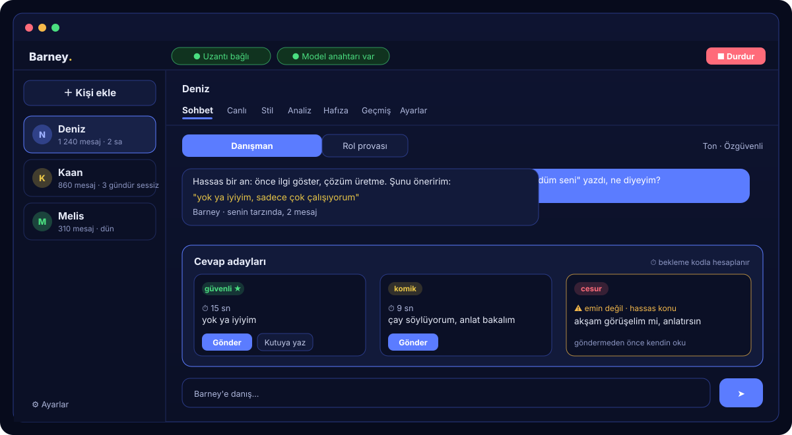
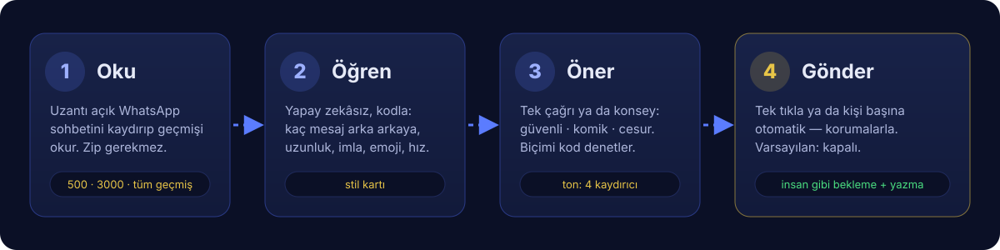
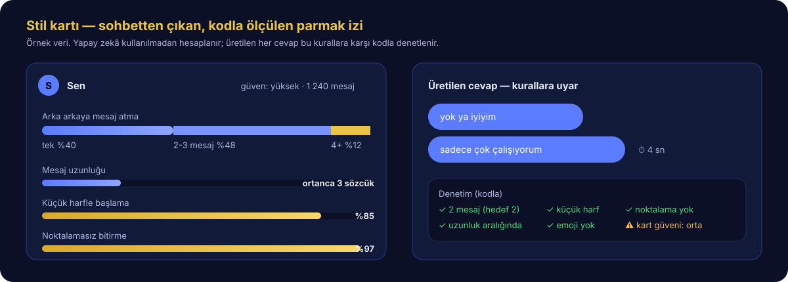
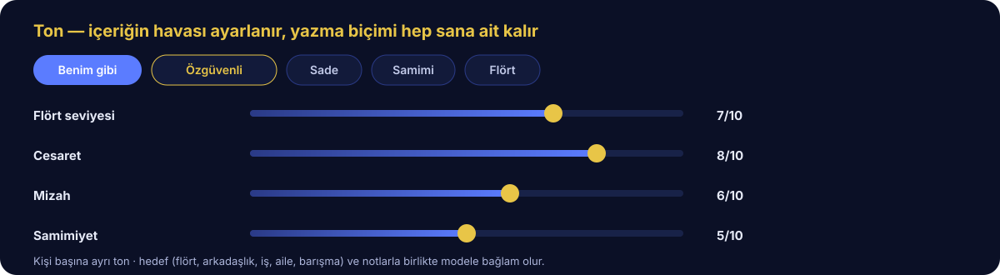
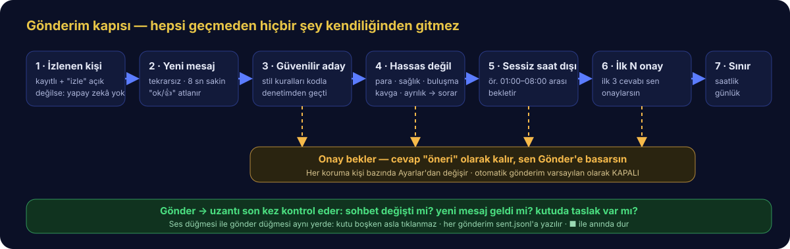
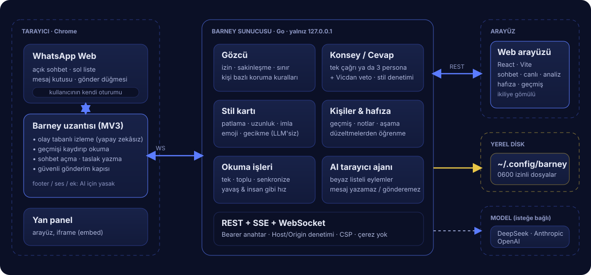

<p align="center">
  
</p>

<p align="center">
  
  
  
  
  
  
</p>

<p align="center">
  <a href="#barney-nedir">Nedir?</a> ·
  <a href="#mantığı">Mantığı</a> ·
  <a href="#özellikler">Özellikler</a> ·
  <a href="#kurulum">Kurulum</a> ·
  <a href="#kullanım">Kullanım</a> ·
  <a href="#güvenlik-ve-gizlilik">Güvenlik</a> ·
  <a href="#mimari">Mimari</a> ·
  <a href="#durum-ve-sınırlar">Durum</a>
</p>

---

<a id="barney-nedir"></a>
## Barney nedir?

**Barney**, WhatsApp Web'de **senin yazma biçimini** öğrenen ve cevapları **senin gibi** yazan bir yazışma asistanıdır.
Kendi bilgisayarında çalışır: tek bir program, içine gömülü bir web arayüzü ve bir Chrome uzantısı.

Paragraf yazan biriysen paragraf yazar. Art arda kısa kısa mesaj atan biriysen o da öyle atar. Küçük harf kullanımın,
noktalama alışkanlığın, emojilerin, uzatmaların, cevap verme hızın… Hepsi geçmiş sohbetlerinden çıkarılır ve üretilen
her cevap bu alışkanlıklara göre denetlenir.

|  |  |
|---|---|
| **Senin üslubunla** | Yapay zekâ yalnızca *ne söyleneceğini* yazar. *Nasıl* yazılacağı (mesaj sayısı, uzunluk, harf, noktalama, emoji, bekleme süresi) koddaki kurallarla belirlenir ve denetlenir. |
| **Yerel ve gizli** | Kişiler, sohbet geçmişi, hafıza ve ayarlar yalnızca senin bilgisayarında durur. Sunucu dışarıya açılmaz. |
| **Kontrol sende** | Otomatik gönderim varsayılan olarak **kapalıdır**. Açsan bile korumalar devrededir ve tek düğmeyle her şeyi durdurursun. |

<p align="center">
  
</p>

> [!IMPORTANT]
> Barney yalnızca **kendi sohbetlerini** yönetmen içindir. Yalan, baskı, kıskandırma ya da manipülasyon üretmemesi için
> istemlerde açık kurallar vardır; yine de gönderilen her mesajın sorumlusu sensin. Kimseyi kandırmak için kullanma.

---

<a id="mantığı"></a>
## Mantığı

<p align="center">
  
</p>

Dört adımda çalışır:

1. **Oku.** Chrome uzantısı, açık WhatsApp sohbetini yukarı kaydırarak geçmişi okur. Dosya dışa aktarmana gerek yoktur.
2. **Öğren.** Geçmişten bir **stil kartı** çıkarılır. Bu adımda yapay zekâ kullanılmaz; her şey sayılarak ölçülür.
3. **Öner.** Yeni bir mesaj geldiğinde model, stil kartına uygun bir cevap yazar. Kurallara uymazsa neyin yanlış olduğu
   söylenerek yeniden yazdırılır.
4. **Gönder.** Cevabı sen tek tıkla gönderirsin ya da o kişi için otomatik gönderimi açarsın. Mesajlar insan gibi
   beklenerek ve harf harf yazılarak gider.

### Stil kartı

<p align="center">
  
</p>

Stil kartı, yazma biçiminin parmak izidir: art arda kaç mesaj attığın, mesajlarının uzunluğu, büyük/küçük harf ve
noktalama alışkanlığın, emoji kullanımın, sana özgü sözcükler ve cevap verme hızın. Karşı taraf için de ayrı bir kart
çıkarılır; böylece cevabın onun tonuna uyar ama sesin senin kalır.

### Yapay zekâ ne zaman çalışır?

Sohbeti izlemek tamamen yereldir ve hiçbir maliyeti yoktur. Model yalnızca şu durumlarda çağrılır:

- izlediğin bir kişiden **yeni** bir mesaj geldiğinde,
- sen **Şimdi öner** dediğinde,
- danışmana bir şey sorduğunda.

Kendi mesajını düzeltmen, silmen ya da elle bir şey yazman ekranı günceller ama modeli çağırmaz.

---

<a id="özellikler"></a>
## Özellikler

<table>
<tr>
<td width="33%" valign="top">

**Canlı öneri**<br>
Yeni mesaj gelince cevap adayları hazırlanır. Her aday için **Gönder**, **Kutuya yaz**, **Düzenle**, kopyala ve sil
düğmeleri vardır.

</td>
<td width="33%" valign="top">

**Art arda kısa mesajlar**<br>
Tek uzun mesaj yerine, senin yaptığın gibi birkaç kısa mesaja böler. Kaç mesaj olacağını söyleyeceği şeye göre seçer.

</td>
<td width="33%" valign="top">

**Konsey**<br>
İstersen tek cevap yerine üç aday alırsın: güvenli, komik ve cesur. Ayrı bir denetçi uygunsuz adayı engeller.

</td>
</tr>
<tr>
<td width="33%" valign="top">

**Otomatik gönderim**<br>
Kişi bazında açılır. İlk cevaplarda onayını ister, sessiz saatlerde göndermez, hassas konuda durur, saatlik ve günlük
sınıra uyar.

</td>
<td width="33%" valign="top">

**Tam otonom mod**<br>
Mesaj gelir gelmez, onay beklemeden cevap verir. Hassas konu koruması ve **Durdur** düğmesi bu modda da çalışır.

</td>
<td width="33%" valign="top">

**Ton ayarı**<br>
Hazır tonlar (Benim gibi, Özgüvenli, Sade, Samimi, Flört) ve dört kaydırıcı: flört, cesaret, mizah, samimiyet.

</td>
</tr>
<tr>
<td width="33%" valign="top">

**Danışman**<br>
Seçtiğin kişinin geçmişini ve hafızasını bilen Barney'e sorarsın: *"ona ne yazayım?"*, *"bunu nasıl yorumlarsın?"*

</td>
<td width="33%" valign="top">

**Rol provası**<br>
Model karşı tarafı **onun** yazma biçimiyle canlandırır. Gerçek mesajı atmadan önce konuşmayı denersin.

</td>
<td width="33%" valign="top">

**Hafıza ve hedef**<br>
Kişi için hedef (flört, arkadaşlık, iş, aile, barışma), notlar, otomatik çıkarılan bilgiler ve ilişki aşaması.

</td>
</tr>
<tr>
<td width="33%" valign="top">

**Tarayıcıdan kişi ekleme**<br>
Açık sohbeti okuyarak kişi ekler. Toplu ekleme, **Senkronize et** (istediğin an durdurulur) ve yalnızca ekrandakileri
alan hızlı **Senk** düğmesi.

</td>
<td width="33%" valign="top">

**Sürekli öğrenme**<br>
Sohbet açıkken gelen ve giden mesajlar kişinin geçmişine kendiliğinden eklenir; stil kartı güncel kalır.

</td>
<td width="33%" valign="top">

**Analiz**<br>
Kim daha çok yazıyor, kim başlatıyor, yanıt süreleri, en aktif saatler, haftalık eğilim. Hepsi yapay zekâsız.

</td>
</tr>
<tr>
<td width="33%" valign="top">

**Düzeltmelerden öğrenme**<br>
Bir öneriyi düzenleyip gönderdiğinde Barney bunu örnek olarak saklar ve sonraki cevaplarda kullanır.

</td>
<td width="33%" valign="top">

**Sessizlik önerisi**<br>
Bir süredir yazışmadığın kişide *"X gündür yazışmadınız"* rozeti ve tek tıkla konu açan öneri.

</td>
<td width="33%" valign="top">

**Yapay zekâ tarayıcı modu**<br>
Normal okuyucu çalışmazsa yapay zekâ sekmeyi gezerek okur. Yalnızca kaydırır, tıklar ve okur; mesaj yazamaz.

</td>
</tr>
</table>

### Ton

<p align="center">
  
</p>

Ton ayarı kişiye özeldir ve hem danışman sohbetinde hem canlı önerilerde geçerlidir.

---

<a id="kurulum"></a>
## Kurulum

### Gerekenler

| Araç | Sürüm | Ne için |
|---|---|---|
| Go | 1.27 | Sunucuyu derlemek |
| Node.js + pnpm | Node 24 | Arayüzü derlemek |
| Google Chrome | 116 ve üzeri | Uzantı |
| Model anahtarı | DeepSeek, Anthropic ya da OpenAI | Cevap üretmek |

### 1. Derle ve çalıştır

```bash
git clone https://github.com/MustafaKemal0146/barney.git
```

```bash
cd barney
```

```bash
make run
```

`make run` arayüzü derler, programın içine gömer ve sunucuyu başlatır. Terminalde şuna benzer bir adres görürsün:

```
http://127.0.0.1:8777/#token=…
```

Bu adresi Chrome'da aç. Adresteki anahtar yalnızca senin bilgisayarında geçerlidir; kimseyle paylaşma.

8777 numaralı kapı doluysa başka bir kapı ver:

```bash
make run PORT=8790
```

### 2. Uzantıyı kur

1. Chrome'da `chrome://extensions` sayfasını aç.
2. Sağ üstten **Geliştirici modu**nu aç.
3. **Paketlenmemiş öğe yükle**'ye bas ve `~/.config/barney/extension` klasörünü seç.
4. `web.whatsapp.com`'u aç (açıksa sayfayı yenile). Arayüzün üstündeki rozet **Uzantı bağlı** olur.

Uzantı güncellendiğinde `chrome://extensions` sayfasında yenile düğmesine bas ve WhatsApp sekmesini de yenile.

### 3. Model anahtarını gir

Arayüzde **Ayarlar** sayfasını aç, sağlayıcıyı seç ve anahtarını gir. Anahtar yalnızca bu bilgisayarda saklanır ve
arayüze bir daha geri gösterilmez.

### 4. İlk kişiyi ekle

1. WhatsApp Web'de kişinin sohbetini aç.
2. Arayüzde **Kişi ekle → WhatsApp'tan oku**'ya bas.
3. Okuma bitince stil kartı hazırdır.

Okuma sırasında WhatsApp sekmesi **görünür** kalmalıdır.

### Komutlar

| Komut | Ne yapar |
|---|---|
| `make run` | Derler ve çalıştırır |
| `make dev` | Sunucu + canlı yenilemeli arayüz (geliştirme için) |
| `make build` | Yalnızca derler → `bin/barney` |
| `make ext` | Uzantı klasörünü yeniden yazar |
| `make doctor` | Kurulumu denetler; hiçbir şeyi değiştirmez |
| `make test` | Go, uzantı ve arayüz testleri |
| `bin/barney url` | Arayüz adresini yazdırır |

---

<a id="kullanım"></a>
## Kullanım

Chrome'da uzantı simgesine basınca Barney, WhatsApp'ın yanında **yan panel** olarak açılır. Her kişinin yedi sekmesi vardır:

| Sekme | İçinde ne var |
|---|---|
| **Sohbet** | Danışman ve rol provası |
| **Canlı** | Açık sohbet, cevap adayları, otomatik gönderim, tam otonom ve ton |
| **Stil** | Senin ve karşı tarafın stil kartı |
| **Analiz** | Yazışma istatistikleri |
| **Hafıza** | Kişi hakkında çıkarılan bilgiler ve ilişki aşaması |
| **Geçmiş** | Önerilen, gönderilen ve düzeltilen cevaplar |
| **Ayarlar** | Hedef, notlar, korumalar ve sınırlar |

Günlük kullanım kısaca şöyledir:

- Mesaj gelir, **Canlı** sekmesinde adaylar belirir. Beğendiğini **Gönder** ile yollarsın ya da **Düzenle** ile değiştirirsin.
- Hiç uğraşmak istemiyorsan o kişi için **Otomatik**'i ya da **Tam otonom**'u açarsın.
- Bir şey ters giderse üstteki **Durdur** düğmesi her şeyi anında keser.

---

<a id="güvenlik-ve-gizlilik"></a>
## Güvenlik ve gizlilik

<p align="center">
  
</p>

**Otomatik gönderim korumaları** (kişi bazında ayarlanır):

- İlk birkaç cevap her zaman onayını bekler.
- Sessiz saatlerde gönderilmez.
- Para, sağlık, kavga, ayrılık gibi hassas konularda durur ve sana sorar.
- Saatlik ve günlük sınır vardır; istersen sayıyı değiştirir ya da sınırsız yaparsın.
- Cevap hazırlanırken karşı taraftan yeni mesaj gelirse eski cevap gönderilmez.
- Mesaj kutusunda senin yazdığın bir taslak varsa dokunulmaz.

**Verilerin nerede durur?**

- Her şey `~/.config/barney` altında, yalnızca senin kullanıcına açık dosyalardadır.
- Sunucu yalnızca `127.0.0.1` adresini dinler; ağdaki başka cihazlar erişemez.
- Arayüz çerez kullanmaz; her istek anahtarla doğrulanır.
- Gönderilen her mesaj yerel bir günlüğe yazılır.

**Dışarıya ne gider?**

- Cevap üretilirken son mesajlar ve stil özeti, **senin seçtiğin** model sağlayıcısına gönderilir. Başka hiçbir yere veri gitmez.
- Telefon numarası, e-posta ve IBAN gibi bilgiler modele gitmeden önce maskelenir.

**Uzantı neye dokunabilir?**

- Okuma ve gezinme işlemleri mesaj kutusuna, gönder, ses ve ek düğmelerine dokunamaz. Bu, model çıktısına güvenilmeden
  koddaki izin listesiyle zorlanır.
- Gönderim yalnızca kutuda metin varken ve düğme gerçekten **Gönder** düğmesiyken yapılır; sesli mesaj düğmesine asla basılmaz.

---

<a id="mimari"></a>
## Mimari

<p align="center">
  
</p>

| Parça | Görevi |
|---|---|
| **Chrome uzantısı** | WhatsApp Web'i okur, yeni mesajı bildirir, cevabı yazıp gönderir |
| **Yerel sunucu (Go)** | Stil kartı, cevap üretimi, korumalar, kişi kayıtları, hafıza |
| **Web arayüzü (React)** | Programın içine gömülüdür; tarayıcıda ya da yan panelde açılır |
| **Model sağlayıcısı** | Yalnızca cevap metnini üretir |

Ayrıntılar: [docs/MIMARI.md](docs/MIMARI.md) · uç sözleşmesi: [docs/API.md](docs/API.md)

---

<a id="durum-ve-sınırlar"></a>
## Durum ve sınırlar

Barney aktif geliştirilmektedir. Dürüst bir özet:

- ✅ Stil kartı, cevap üretimi, konsey, korumalar, tam otonom mod, danışman, rol provası, hafıza, analiz, yan panel ve
  tarayıcıdan okuma, otomatik testlerle kapsanır.
- ⚠️ **WhatsApp Web arayüzü değişebilir.** Uzantının kullandığı seçiciler tek yerde toplanmıştır
  (`extension/content.js` içindeki `SEL`). Mesaj paneli gerçek sayfaya göre yazılmıştır; sol sohbet listesi ve arama kutusu
  seçicileri henüz doğrulanmamıştır. Toplu ekleme ve arayüzden sohbet açma bunlara dayanır.
- ⚠️ Geçmiş okunurken WhatsApp sekmesi görünür olmalıdır.
- ⚠️ Yalnızca birebir sohbetler desteklenir; grup sohbetleri desteklenmez.
- ⏳ Instagram DM ve telefondan erişim henüz yoktur.

## Lisans

Apache-2.0 — bkz. [LICENSE](LICENSE).
